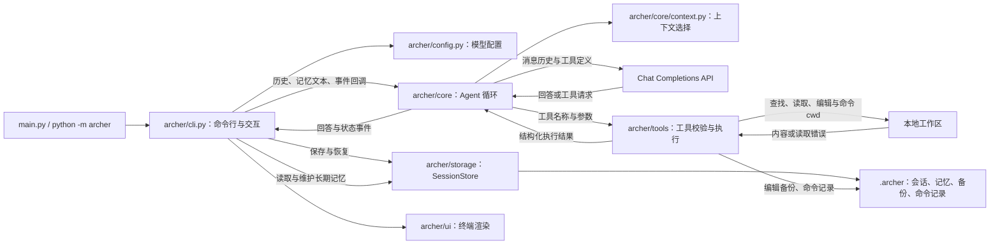

# Archer

Archer 是一个基于 Python 的终端代码 Agent。它通过模型工具调用定位、读取和修改本地代码，并可执行前台命令完成验证。当前版本支持**多轮对话、会话保存与恢复、项目记忆、代码行号引用，以及可选的文件编辑和命令执行**。默认开放只读工具，通过启动参数分别开启编辑和命令能力。

## 功能

- **多轮对话**：交互模式下可以连续提问，历史在会话内复用；`/new` 开始新会话，`/exit` 保存退出。
- **会话持久化**：成功轮次完整保存到工作区 `.archer/sessions/<id>.json`；`--continue` 恢复最近一个有内容的会话，`--session ID` 指定会话，`/sessions` 列举会话。
- **上下文管理**：完整存档独立于模型上下文；按完整对话轮次、消息数和 UTF-8 JSON 大小选取最近历史，保留工具调用与结果的配对。
- **长期记忆**：`/remember` 添加并去重、`/memory` 查看、`/memory-update` 更新、`/forget` 删除；最近添加或更新的条目优先进入 system prompt，每轮显示选用与省略数量，可用 `--no-memory` 关闭。
- **模型接入**：使用 OpenAI Python SDK，支持配置 API Key、模型 ID 和兼容服务地址。
- **工具调用**：支持 `read_file`、`find_files`、`search_text`、`list_directory`、`edit_file`、`restore_file`、`run_command`，由本地程序校验参数和开放能力后执行；结果和错误按调用 ID 回传。
- **文件定位与引用**：文件名/相对路径支持子串和 glob 搜索；读取、文本搜索结果返回实际路径和行号，供回答使用 `path:line` 或 `path:start-end` 引用。
- **文件编辑**：精确原文替换、显式批量替换与新文件创建，返回统一 diff；编辑前备份，可按备份 ID 撤销，保留 UTF-8 BOM 和既有 LF/CRLF 换行。
- **命令执行**：使用参数数组运行前台进程，返回退出码、合并输出和执行记录 ID；限制耗时、输出量，并清理关联子进程。
- **文件读取**：支持工作区内的 UTF-8 文本，单次读取结果最多 64 KiB；可按行读取大文件片段。
- **文本搜索与目录浏览**：按字符串搜索并返回文件路径、行号和内容，也可查看有深度和条目上限的目录树。
- **执行控制**：限制每轮模型请求次数、工具调用数量、工具输出量、消息大小和执行时间；本地扫描另有限额，最后一次模型请求保留给回答。
- **终端输出**：展示模型与工具状态，支持 Markdown 排版、代码高亮、纯文本输出和窗口尺寸适配。
- **离线测试**：通过模拟模型接口验证工具循环、多轮历史、会话与记忆、终端显示行为。

## 架构



各模块的职责如下：

| 模块 | 职责 |
| --- | --- |
| `main.py` | 启动 CLI，将返回值作为进程退出码 |
| `archer/__main__.py` | 支持 `python -m archer` 启动 |
| `archer/cli.py` | 参数解析、能力开关、交互循环、用户命令、回答展示与会话保存 |
| `archer/config.py` | 模型配置加载、必需项校验与项目根目录定位 |
| `archer/core/agent.py` | ReAct 循环、执行预算、工具结果回传；返回回答与本轮新增消息 |
| `archer/core/context.py` | 按完整轮次和大小预算选择历史，不修改完整存档 |
| `archer/tools/registry.py` | 统一登记 schema、执行函数和所需能力，校验参数并分发工具 |
| `archer/tools/filesystem.py` | 工作区路径检查、文件名搜索、文件读取、行号引用与目录浏览 |
| `archer/tools/editing.py` | 精确替换、创建文件、差异和备份恢复 |
| `archer/tools/commands.py` | 前台进程、时间/输出预算、进程树回收与执行记录 |
| `archer/storage/session.py` | 会话保存/加载/列举、格式兼容、记忆增删改查与上下文选择 |
| `archer/storage/files.py` | 共享 JSON 原子写入和操作记录目录检查 |
| `archer/ui/terminal_ui.py` | 输入提示、状态日志、Markdown 回答与代码高亮 |
| `archer/ui/terminal_art.py` | 启动面板、窗口尺寸适配、颜色检测与终端兼容处理 |
| `tests/test_package.py` | 脚本与模块入口、项目配置路径及预览版本信息 |
| `tests/test_main.py` | 模型协议、工具执行、多轮对话、会话恢复、记忆注入与异常处理 |
| `tests/test_context.py` | 完整轮次选择、工具配对、UTF-8 大小预算与输入不变性 |
| `tests/test_tools.py` | 凭据与工作区边界、链接遍历、大文件按行读取及返回大小限制 |
| `tests/test_operations.py` | 文件名查找、引用、能力限制、编辑恢复、命令退出/超时/输出与子进程回收 |
| `tests/test_session.py` | 会话与记忆存储、非法 ID、损坏文件容错 |
| `tests/test_terminal_art.py` | 启动面板布局与终端兼容测试 |
| `tests/test_terminal_ui.py` | 回答渲染、状态配色与输出通道测试 |

### 执行流程

1. 解析参数，加载模型配置；按 `--session` / `--continue` 恢复会话，否则新建。
2. 进入多轮循环：读取用户消息；`/` 开头的命令由程序处理，其余作为新一轮问题。
3. CLI 读取记忆并准备历史；核心按预算选择上下文，把 system prompt、最近完整轮次和新问题发给模型。工具调用按 ID 配对执行。
4. 核心返回有效回答与本轮新增消息；CLI 将消息追加到完整存档，展示回答并保存。失败轮次不会混入历史。
5. `/exit`、EOF 或 Ctrl+C 退出；`/new` 保存当前会话并开始新会话。空会话不会自动保存，未修改的会话不会重复写入。

一个模型响应中包含多个工具调用时，程序按顺序执行。工具执行失败会作为结构化结果回传，供模型继续处理。

核心循环不依赖终端对象或本地存储对象，不修改调用方传入的历史。工具定义与执行函数使用同一份注册表，新增工具无需另加参数白名单或执行分支；缺少执行函数的注册会明确报错。

回答先显示，再尝试保存。交互模式下保存失败时，对话保留在内存，可用 `/save` 重试，无需再次请求模型；`/exit` 和 `/new` 保存失败时保留当前会话。单次提问或 EOF 退出时若保存失败，程序返回非零退出码。

编辑与命令执行会立即产生实际效果。后续模型失败或对话保存失败不会自动回滚它们；编辑备份和命令记录独立于会话保存，操作完成后终端直接显示记录 ID、编辑差异或命令输出。可要求 Agent 使用 `restore_file` 和对应备份 ID 撤销一次编辑；命令产生的任意文件变化不纳入编辑备份。

### 工具

| 工具 | 参数与返回 |
| --- | --- |
| `read_file` | `path` 必填；可传 `start_line`、`end_line`；返回 `content`、`path`、实际 `start_line`/`end_line`、`reference`，正文最多 64 KiB |
| `find_files` | `pattern` 必填；按文件名子串或 glob 查找，含 `/` 时匹配相对路径；支持 `path`、`max_results`，默认忽略大小写 |
| `search_text` | `query` 必填；支持 `path`、`case_sensitive`、`max_results`；返回路径、行号、匹配行和 `reference` |
| `list_directory` | 支持起点 `path`、递归深度 `max_depth`；返回目录树、条目数与截断标记 |
| `edit_file` | 需 `--allow-write`；`path`、`old_text`、`new_text` 必填；现有非空文件要求精确原文，默认唯一匹配；可用 `replace_all`，新建文件的 `old_text` 为空 |
| `restore_file` | 需 `--allow-write`；传入 `backup_id` 恢复该次编辑前状态；目标有后续修改时拒绝覆盖，撤销新建会删除该文件 |
| `run_command` | 需 `--allow-exec`；`argv` 为字符串数组；可传 `cwd`、`timeout_seconds`、`max_output_bytes`、`encoding`；返回退出码、合并输出、超时/截断标记和记录 ID |

搜索默认最多返回 50 条，最多可指定 200 条；单个匹配行最多显示 300 个字符，跳过超过 1 MiB 的文件和疑似二进制文件。目录树默认最多 300 项，递归深度最多为 5。搜索和目录浏览默认跳过版本库、虚拟环境、依赖及本地运行数据目录，遍历时不跟随符号链接或目录联接。

单次递归遍历最多检查 5,000 个目录子项，搜索最多检查 1,000 个文件、读取约 16 MiB 内容；本地扫描时间预算为 5 秒。按行读取也受扫描字节与时间预算限制，避免为很大的起始行号无限扫描。搜索或目录浏览达到扫描预算时，返回已有结果、`truncated` 与 `limit_reason`；搜索发现超出结果数量上限的额外匹配时也标记 `truncated`，恰好达到上限且搜索完整时不误报。大目录只对预算内的子项排序。

文件读取、搜索、目录浏览和编辑均校验实际路径，拒绝访问工作区之外的目标和 Archer 自身的 `.env`。编辑额外拒绝 `..`、符号链接/目录联接和 `.git`、`.archer` 内部数据路径。

`find_files` 与目录遍历共用条目和时间预算，不读取文件内容；glob 使用字符串匹配，含 `/` 的模式作用于工作区相对路径，不使用 Git ignore 模式语义。读取引用的行号从 1 开始，结束行为实际读到的最后一行；空文件返回 0/0 和不带行号的文件路径。引用位置由工具提供，模型是否正确使用仍需核对回答。

编辑文件最多 1 MiB，差异最多显示 8 KiB；旧原文不匹配或默认匹配多处时不写入。写入前再次检查目标内容，使用同目录临时文件替换；备份记录原始字节，因此撤销保留原编码标记及换行。恢复只允许当前文件仍与该次编辑结果一致的情况。撤销新文件保留已创建的空父目录。

命令默认 30 秒、最多 60 秒，并受本轮剩余时间限制；输出默认 16 KiB、最多 64 KiB，超出时停止进程。stdout/stderr 合并，默认按 UTF-8 解码，旧 Windows 程序可指定 `encoding=gb18030`。命令禁用交互输入，`argv` 默认不经 shell；需要管道、重定向或 shell 内置命令时，应显式选择相应解释器。Windows 使用带启动信号的进程包装与 [Job Object](https://learn.microsoft.com/en-us/windows/win32/procthread/job-objects) 管理进程树，POSIX 使用独立进程组；前台命令结束或中断后回收关联子进程。

`cwd` 仅限制命令的起始目录。**命令以当前用户权限运行，并非操作系统沙箱，可以自行访问其他路径、网络或修改文件。** `--allow-exec` 独立于 `--allow-write`：即使未开启编辑工具，命令自身仍可写文件。子进程不继承名为 `API_KEY` 或以 `_API_KEY` 结尾的环境变量，其他常规环境变量仍保留；这不阻止命令自行读取本地配置。能力开关只对本次启动有效，恢复会话不会自动恢复写入或执行权限，也没有逐条工具确认。

## 环境要求

- Python 3.12 或更高版本
- [uv](https://docs.astral.sh/uv/) 项目管理工具
- 支持 **Chat Completions function tools / tool_calls** 的模型服务

当前实现使用 `client.chat.completions.create()`。仅提供 Responses API 的服务不适用于当前版本。

## 安装与配置

在仓库根目录安装依赖：

```shell
uv sync --locked
```

复制配置示例。PowerShell：

```powershell
Copy-Item .env.example .env
```

macOS / Linux：

```shell
cp .env.example .env
```

编辑 `.env`，填写模型服务配置：

```dotenv
OPENAI_API_KEY=your-api-key
OPENAI_MODEL=your-model-id

# 使用兼容服务时设置 API 根地址；使用 SDK 默认地址时可省略。
# OPENAI_BASE_URL=https://your-provider.example/v1
```

也可以通过环境变量设置以上配置。**环境变量优先于 `.env`**。程序仅读取 Archer 项目根目录中与 `pyproject.toml` 同级的 `.env`，不会加载目标工作区的配置文件。

`.env` 不应提交到版本库；`.env.example` 仅保存公开的配置模板。实际提问会请求配置的模型服务，用量和费用由该服务计量。

## 使用

单次提问（执行一轮后退出）：

```shell
uv run python main.py "读取 README.md，概括项目的功能与架构"
```

多轮对话（省略问题参数）：

```shell
uv run python main.py
```

也可以使用包入口，参数与 `main.py` 相同：

```shell
uv run python -m archer
uv run python -m archer --help
```

恢复最近一次会话并继续：

```shell
uv run python main.py --continue
```

指定会话 ID 继续：

```shell
uv run python main.py --session 20261021-130000-abcd
```

指定工作区、次数上限，或关闭记忆注入：

```shell
uv run python main.py "读取 README.md" --workspace ./path/to/project --max-steps 8
uv run python main.py --continue --no-memory
uv run python main.py --max-tool-calls 12 --max-tool-bytes 131072 --context-bytes 262144 --max-seconds 120
```

开启编辑和命令执行：

```shell
uv run python -m archer --workspace ./path/to/project --allow-write --allow-exec
```

可连续要求：先按文件名找到目标、引用相关行解释，再修改指定逻辑并运行相关测试。撤销示例：`撤销备份 ID 为 <backup_id> 的那次编辑`。

关闭启动面板，保留终端回答配色：

```shell
uv run python main.py "读取 archer/cli.py，概括其职责" --banner off --color always
```

### 交互命令

| 命令 | 说明 |
| --- | --- |
| `/exit`、`/quit` | 保存会话并退出 |
| `/help` | 显示命令帮助 |
| `/new` | 保存当前会话，开始新会话 |
| `/save` | 保存当前会话；失败后可重试，不请求模型 |
| `/session` | 显示当前会话 ID、消息数和保存路径 |
| `/sessions` | 按更新时间列出已保存的有效会话 |
| `/history` | 查看最近 10 条消息 |
| `/memory` | 查看长期记忆 |
| `/remember 文本` | 添加一条长期记忆；重复内容返回已有条目 |
| `/memory-update ID 文本` | 更新条目并保留 ID，更新后的条目优先注入 |
| `/forget ID`、`/forget all` | 删除一条或全部长期记忆 |

### 命令行参数

| 参数 | 说明 | 默认值 |
| --- | --- | --- |
| `prompt` | 单次问题；省略时进入多轮对话 | 无 |
| `--workspace PATH` | 工具允许读取的工作区，也是 `.archer` 数据目录所在位置 | 当前工作目录 |
| `--max-steps N` | 每轮的模型请求次数上限 | `8` |
| `--max-tool-calls N` | 每轮工具调用数量上限 | `16` |
| `--max-tool-bytes N` | 每轮工具结果正文 UTF-8 字节总上限 | `131072` |
| `--context-bytes N` | 每次模型请求中消息列表的 UTF-8 JSON 大小上限 | `262144` |
| `--max-seconds N` | 每轮执行时间预算，秒 | `120` |
| `--session ID` | 加载指定会话后继续 | 无 |
| `--continue` | 恢复最近一个有内容的会话；与 `--session` 互斥 | 关闭 |
| `--no-memory` | 本轮不注入长期记忆 | 关闭 |
| `--allow-write` | 开放精确文件编辑、新建与备份恢复 | 关闭 |
| `--allow-exec` | 开放以当前用户权限运行的前台命令 | 关闭 |
| `--color auto\|always\|never` | 自动检测、强制开启或关闭输出配色 | `auto` |
| `--banner auto\|color\|plain\|off` | 自动、彩色、纯文本或关闭启动面板 | `auto` |
| `--preview` | 预览界面与示例输出，不读取任务文件、不请求模型 | 关闭 |
| `--help` | 显示命令帮助 | — |

`--color` 同时影响对话配色和默认启动面板；显式传入 `--banner` 可单独覆盖启动面板的显示方式。自动模式在重定向输出或终端不支持颜色时使用纯文本。

上下文先保留 system prompt 与当前轮次，剩余预算用于最近的完整历史轮次，最多 80 条历史消息。预算按 UTF-8 JSON 字节计算，包含消息字段和转义开销，并非精确 token 数；工具 schema 不计入该消息预算，具体模型的 token 上限仍需按服务配置选择合适的预算。

工具输出不足时返回对应调用 ID 的结构化错误，并停止后续实际工具执行，让模型基于已有结果回答。一批工具请求超过剩余调用数量时整批拒绝；最后一次模型请求或工具预算用完后会发送 `tool_choice=none`，若服务仍返回工具请求则报错，不执行额外工具。

### 本地数据

| 路径 | 内容 |
| --- | --- |
| `.archer/sessions/<id>.json` | 会话元数据与消息历史（含工具结果） |
| `.archer/memory.json` | 长期记忆条目（用户可读、可删） |
| `.archer/backups/<id>.json` | 编辑前原始字节（Base64）、路径及前后内容指纹 |
| `.archer/commands/<id>.json` | 命令参数、cwd、状态、退出码和受限输出 |
| `.archer/.gitignore` | 忽略该数据目录内的文件 |

程序在目标工作区的 `.archer/` 内生成独立的 Git 忽略规则，使用 `--workspace` 指向其他仓库时也生效。忽略规则不影响已经被 Git 跟踪的文件；若此前提交过会话或记忆，需要另行从版本控制中移除。

会话与记忆兼容 UTF-8 和带 BOM 的 UTF-8 文件。指定会话恢复时会校验会话 ID、工作区、元数据、消息结构和工具调用配对；`--continue` 跳过无效会话。损坏的记忆文件会报错并保留原内容，需修复后继续使用记忆功能，也可通过 `--no-memory` 暂时关闭注入。

两类 JSON 都使用 `schema_version: 1`。没有版本字段的旧数据按 v0 读取，内存中升级，下一次实际保存时写入新格式；未知版本拒绝读取，不覆盖原文件。旧版本已经从存档中裁掉的消息无法通过格式升级恢复。会话仍绑定原工作区路径，移动项目后需要明确迁移路径信息。

长期记忆按工作区隔离，最多 50 条，每条最多 2,000 字，默认注入预算为 3,000 字符（含说明文字）。最近添加或更新的条目优先，放不下的条目跳过后继续选择其他条目；CLI 显示选用与省略数量。重复判断忽略多余空白，不推断语义是否相同；矛盾记忆需要用户更新或删除。

## 测试

运行全部测试：

```shell
uv run python -m unittest discover -s tests -v
```

模型接口测试使用 `httpx2.MockTransport` 返回模拟响应，并在临时工作区实际执行文件读取。测试不会请求真实模型服务。

覆盖范围包括：

- 工具调用与结果的 ID 配对、多个工具调用和连续工具轮次。
- 脚本与包入口、移动后的项目配置路径、预览模式和版本信息。
- JSON 参数、工作区路径、文件大小、编码和凭据配置访问校验。
- 递归搜索的凭据保护、符号链接或 Windows 目录联接边界，以及大文件按行读取。
- 配置优先级、请求次数上限、空响应及不完整响应处理。
- 完整存档与有限上下文分离、按完整轮次选取、输入历史不变性。
- 文件名子串/glob、准确引用行号、默认能力过滤及禁用工具的分发拒绝。
- 精确替换、创建、BOM/CRLF 保留、备份恢复、后续改动保护和差异截断。
- 命令 cwd、退出码、UTF-8、shell 字符按普通参数传递、超时、输出上限和子进程清理。
- 模拟模型的一轮“查找 → 读取 → 编辑 → 运行 → 复读 → 回答”及模型失败后的备份保留。
- 工具调用数、累计输出、上下文大小、执行时间与本地扫描预算。
- 多轮历史复用、`--continue` 跳过空会话、会话列表、记忆注入与更新去重。
- JSON 旧格式升级、未知版本保护、未变更会话避免重复写入。
- 会话与记忆的保存/加载、BOM 编码、损坏文件保护和恢复校验。
- 目标工作区的数据忽略规则、保存失败后的回答展示与重试。
- EOF 或 Ctrl+C 退出时的保存失败状态、会话恢复时的读取错误处理。
- 终端宽高适配、中文显示、Markdown 与代码高亮、纯文本回退。

## 项目结构

```text
Archer/
├── main.py
├── archer/
│   ├── __init__.py
│   ├── __main__.py
│   ├── cli.py
│   ├── config.py
│   ├── core/
│   │   ├── __init__.py
│   │   ├── agent.py
│   │   └── context.py
│   ├── tools/
│   │   ├── __init__.py
│   │   ├── registry.py
│   │   ├── filesystem.py
│   │   ├── editing.py
│   │   └── commands.py
│   ├── storage/
│   │   ├── __init__.py
│   │   ├── session.py
│   │   └── files.py
│   └── ui/
│       ├── __init__.py
│       ├── terminal_ui.py
│       └── terminal_art.py
├── tests/
├── .env.example
├── .gitignore
├── pyproject.toml
└── uv.lock
```

`pyproject.toml` 声明项目与依赖，`uv.lock` 固定解析后的依赖版本；两者均应纳入版本管理。运行时数据写入工作区 `.archer/`，不纳入版本管理。

## 当前限制

- 完整会话存档保留成功轮次，但模型只能看到预算内最近的完整轮次，不做自动摘要或语义检索。
- 长期记忆需要手动维护，不会自动从对话中总结；记忆按工作区隔离。
- 会话文件包含完整工具结果，长期使用后可能变大，需要手动清理 `.archer/sessions/`。
- 本地 JSON 存储面向单进程使用；原子替换防止半写文件，不提供多个进程同时修改时的合并或锁定。
- 编辑支持 UTF-8 文本的精确替换和新建，不支持任意格式补丁、二进制编辑或多文件事务。
- 文件路径参数与命令 `cwd` 接受工作区内的相对路径；命令的可执行文件和参数另按进程语义处理。文件读取要求 UTF-8（支持 BOM），全文超过 64 KiB 时需指定行号，所选片段仍受 64 KiB 限制。
- 文本搜索是逐文件字符串匹配，不包含语义检索或符号索引。
- 路径校验属于应用层限制，不构成操作系统沙箱，也不保证抵御并发路径替换。
- 编辑备份、命令记录需要手动清理；执行命令导致的修改不会自动生成编辑备份，不能统一撤销。
- SDK HTTP 超时最多为 30 秒，并按剩余执行时间缩短，自动重试关闭。执行与扫描时间预算在操作边界检查，不能强制终止阻塞的操作系统调用，也不等同于硬实时截止时间。

## 后续规划

- 上下文摘要与压缩，提高长会话中较早信息的可用性。
- 符号定位与引用交叉校验。
- 多文件编辑检查点和可选的逐次操作确认。

以上功能尚未实现。
